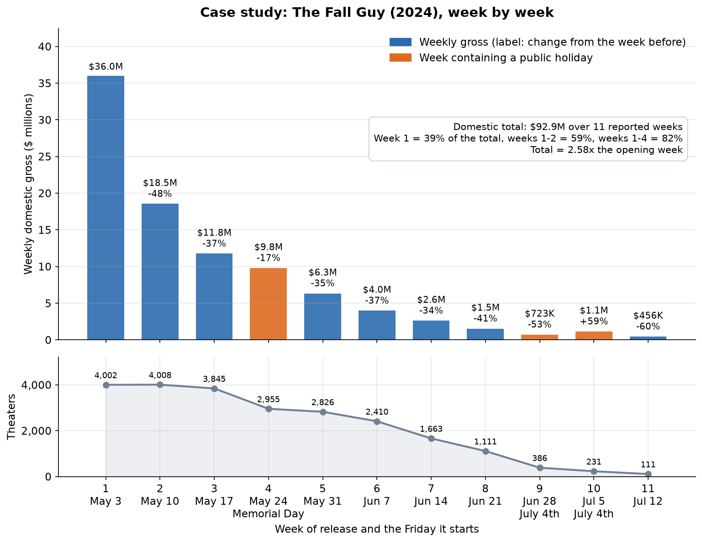
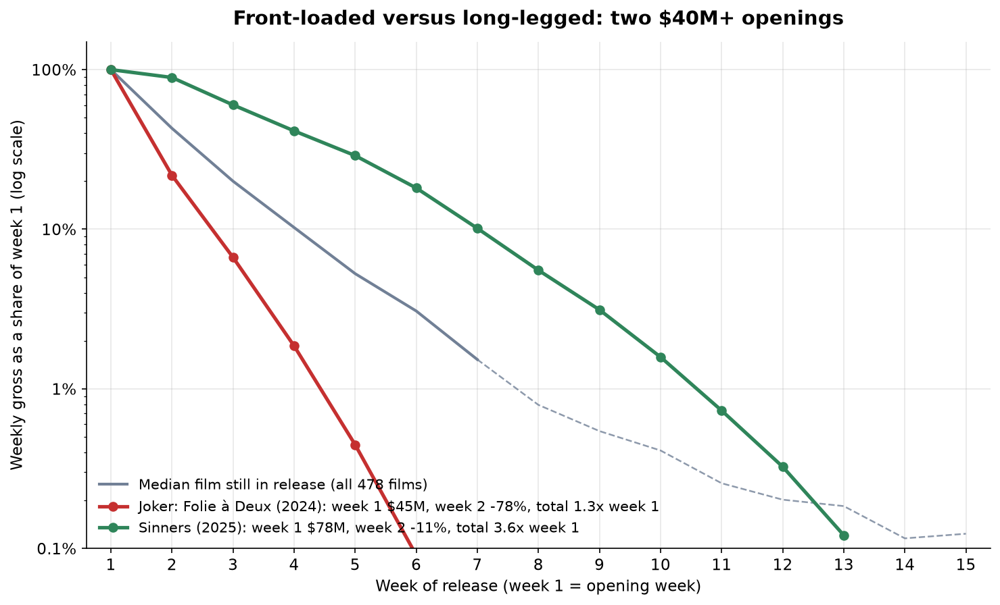
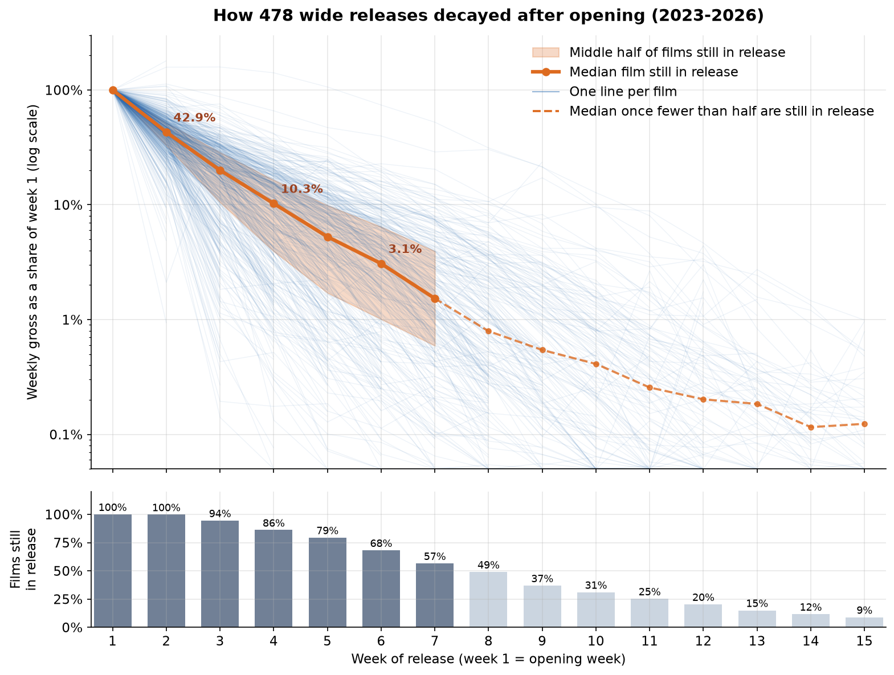
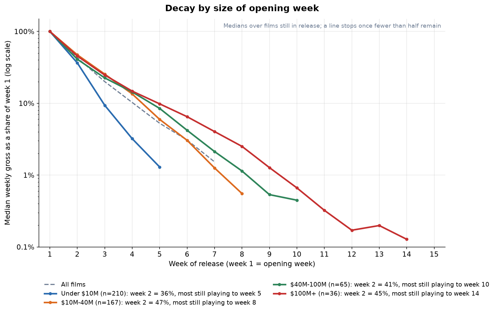
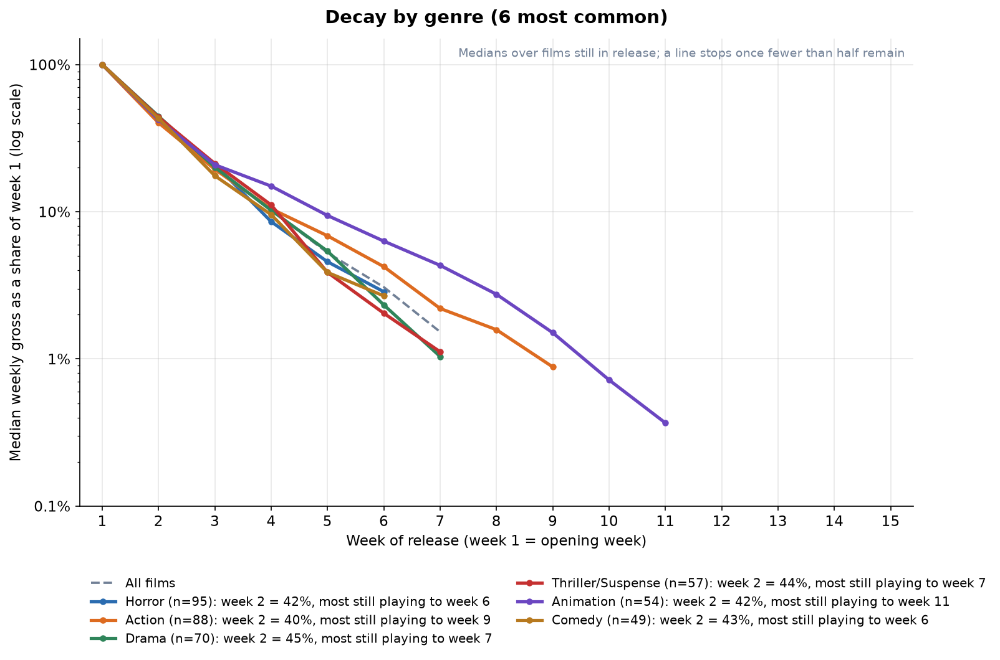
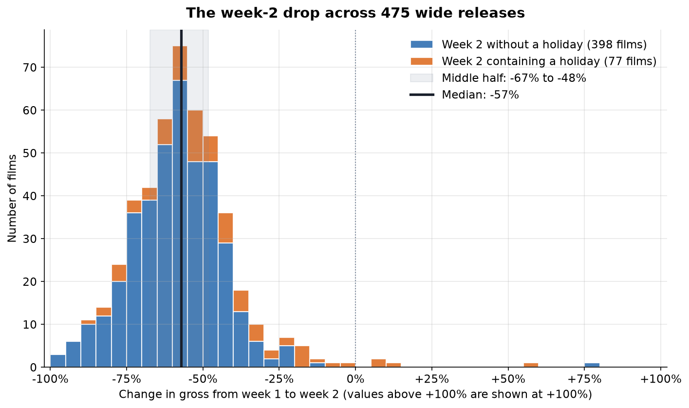
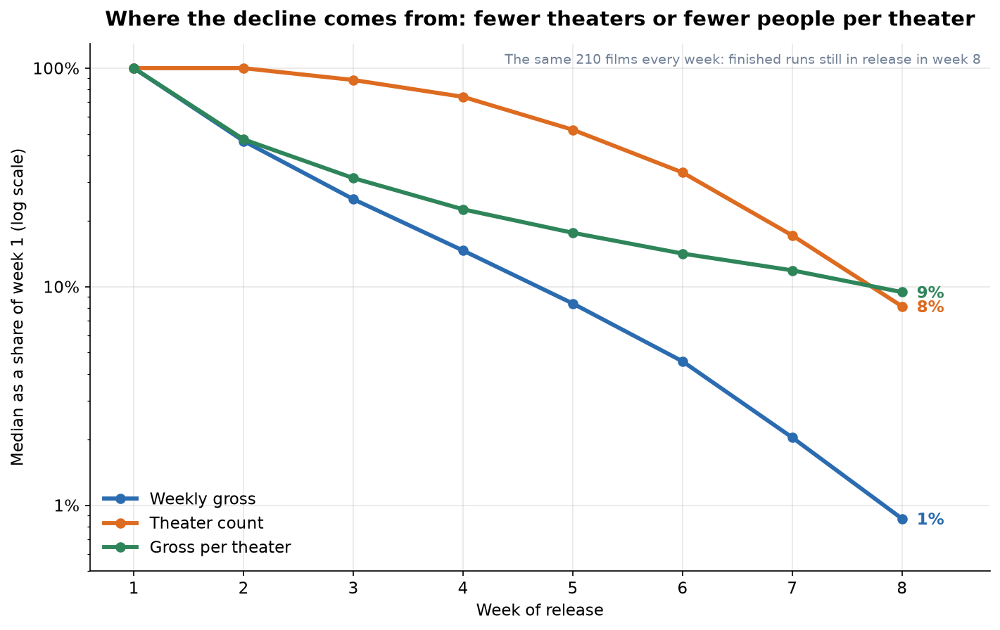
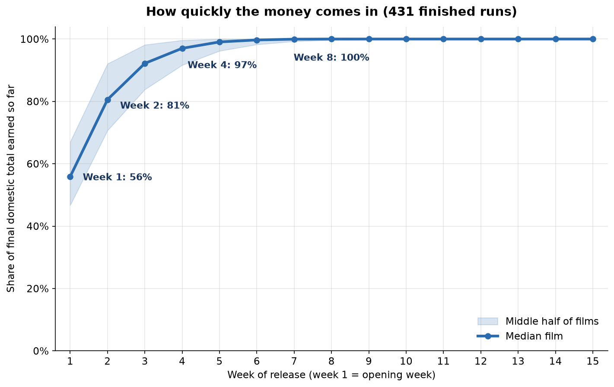

# How box office runs decay, week by week

Wide releases in US and Canadian theaters, January 2023 to October 2026. Data from [The Numbers](https://www.the-numbers.com/weekly-box-office-chart), collected on October 12, 2026 (latest complete chart: the week starting Friday, October 2, 2026).

## Summary

- **A typical wide release loses about half its audience every week.** The median film still in theaters takes 43% of its opening-week gross in week 2, 20% in week 3, 10% in week 4 and 3% in week 6. The median week-over-week change stays between -50% and -57% from week 2 through week 11. On a log scale that is a straight line: the decay is close to geometric.
- **Most of the money arrives immediately.** The median finished run earns 56% of its domestic total in week 1, 81% by the end of week 2 and 97% by the end of week 4. The median total is 1.79 times the opening week, and only 4% of films reach 3 times.
- **The week-2 drop clusters tightly around -57%.** The middle half of films fall between 48% and 67%. Seven in ten fall more than 50%, one in five more than 70%, and only five films (1%) grew. Holidays in week 2 soften the median drop to -50%. A weak week 2 tends to be followed by steeper weekly drops afterwards.
- **Size and genre change how long a film lasts more than how hard it falls in week 2.** Week-2 retention is 36% to 47% in every opening-size group and 40% to 45% in every common genre. After that the paths split. Most films that opened under $10M are gone by week 6. Half of $100M+ openers are still playing in week 14, and animation outlasts every other genre.
- **Early declines are audiences, later declines are screens.** Theater counts hold at 100% in week 2 while per-theater takings fall by more than half. By weeks 6 to 8, lost theaters account for most of the remaining decline.

## The data and how it was handled

**Source.** [scrape.py](scrape.py) read all 196 weekly domestic charts from January 6, 2023 to October 2, 2026. Each chart covers a Friday-to-Thursday week. The scraper then visited each qualifying film's page for its week-by-week and weekend-by-weekend tables and its details (genre, distributor, budget, rating). Requests were spaced 2 seconds apart and every page is cached in `data/raw/`, so re-running costs nothing.

**Which films count.** A film enters the sample if its first chart appearance is marked "new", it played in at least 1,000 theaters that week, and it had been in release 7 days or fewer. The day limit drops re-releases such as "Avengers Endgame: Encore" (2,723 days in release) and films that played in a few theaters before going wide. That rule found 513 openings. I then removed 35 that are not ordinary new releases:

- **28 event releases.** These include TV episodes (The Chosen), concert and stage recordings (The Eras Tour, Hadestown, Six), sing-alongs and release parties. All of them are booked for a fixed few days, so their "decay" is a scheduling decision, not audiences thinning out. The rule removes anything classed as a special engagement or concert/performance, or distributed by Fathom, AMC Theatres Distribution or Netflix. Fathom specializes in short "event" engagements, and AMC Theatres Distribution and Netflix released only events in this period. The rule also catches a few Fathom titles that ran like ordinary films, such as The Blind (7 weeks).
- **5 older films.** Soul, Turning Red, Luca and Hamilton streamed for years before their theatrical runs, and Kill Bill: The Whole Bloody Affair is a recut of 2003-04 films.
- **2 platform releases.** Saltburn and Marty Supreme opened in a handful of theaters and went wide mid-week, so their first week is mostly a limited run.

That leaves **478 films**: 107 opening in 2023, 123 in 2024, 136 in 2025 and 112 so far in 2026. The median film opened in 3,003 theaters and grossed $11.6M in its first week.

**What "week 1" means.** Week 1 is the opening Friday-to-Thursday week, including Thursday previews. 34 films opened mid-week, such as Wednesday before Thanksgiving or Christmas Day, so their first chart week has only 1 to 4 days in it. Those days are folded into the first full week, the way a "5-day opening" is usually quoted. Moana 2 is an example: its 2-day first chart week ($85.7M) and first full week ($162.4M) together make a $248.0M week 1. Without this, its week 2 would show a misleading +90%.

**Films that stop reporting.** The charts only include films whose distributors report full-week grosses. The analysis treats a film as "still in release" while it keeps reporting. Every curve of gross over time is a median over the films still in release that week, and each figure shows separately what share are still reporting. Counting departed films as zero would make the median hit zero at week 8 just because half the films had gone, which mixes "how fast takings fall" with "how long films stay".

**Small repairs.**
- Sometimes a distributor reported a weekend but not the full week around it, usually the last weekend of a run. I estimated those 76 weeks, across 71 films, from the weekend gross and the film's own ratio of full-week to weekend gross.
- Eight films (Oppenheimer, Wicked, Sinners, Godzilla Minus One, Spider-Man: Across the Spider-Verse, Suzume, Longlegs and Demon Slayer: Infinity Castle) have a later re-release in the same weekly table. Each run is cut at the first absence of 3 or more weeks, so the re-release isn't counted as part of the original run.

**Finished and unfinished runs.** The 47 films that opened on or after June 19, 2026, within 16 weeks of the latest chart, are still playing. They appear in the curves for the weeks they have played so far. They are left out of anything that needs a final total: the cumulative-share figure and the total-to-opening multiples.

**Checks that passed.** Every film's week-1 gross on its own page matches the weekly chart to within 1% (513 of 513). Every week number on the movie pages agrees with its date, and no film-week is duplicated.

---

## 1. Case study: The Fall Guy (2024)



The Fall Guy (Universal; Action; $125M budget) opened on May 3, 2024 with $36.0M in 4,002 theaters and finished with $92.9M domestic over 11 reported weeks. It shows the parts of a typical run clearly, though it held up better than the median film.

- **Week 2 (-48%).** The theater count did not move (4,008), so the entire drop is fewer people per screen. That is the initial burn-off: the people who were waiting to see it went in week 1.
- **Weeks 3 to 4.** Week 3 fell another 37%. Week 4 contained Memorial Day and fell only 17%, even though it lost almost 900 theaters (3,845 to 2,955). Across the sample, Memorial Day weeks are not gentler than usual (section 6), but 2024's was unusually quiet. Its biggest openers, Furiosa ($38.9M) and The Garfield Movie ($37.6M), were far smaller than The Little Mermaid ($146M) in 2023 or Lilo & Stitch ($217M) in 2025, and the whole chart grossed $162M that week, against $250M to $398M in the other three years. With little new competition, the holiday helped holdovers.
- **Weeks 5 to 8.** These are the steady phase, with drops of 34% to 41% a week while theaters fell from 2,826 to 1,111 as new summer releases took screens.
- **Weeks 9 to 10.** These are the Fourth of July weeks. July 4, 2024 was a Thursday, so the holiday sits at the end of week 9 and the long weekend (Friday July 5 to Sunday July 7) is in week 10. Week 9 fell 53% as theaters collapsed to 386. Week 10 rose 59% on just 231 theaters, and per-theater takings jumped from $1,874 to $4,978. The daily figures place the jump on the holiday weekend itself: $347K on Friday July 5 against $83K on July 4. The data can't say which venues drove it.
- **Week 11** was the last reported week (-60%, 111 theaters).

Week 1 delivered 39% of the final total, weeks 1-2 delivered 59%, and weeks 1-4 delivered 82%. The total was 2.58 times the opening week. For comparison, the median film in the sample earns 56% of its total in week 1 and ends at 1.79 times. The Fall Guy's run was leggier than most, but legs couldn't make up for the opening: its $92.9M domestic total is still below its $125M production budget.

## 2. Two openings, opposite shapes: Joker: Folie à Deux and Sinners



These two films were picked by rule rather than by hand. Among the 65 films that opened to $40M or more on a Friday, finished their runs, and had no holiday in week 2, they have the steepest and the gentlest week-2 change. Both were released by Warner Bros. The y-axis is each week's gross as a share of that film's own week 1, on a log scale. A straight line therefore means a constant weekly percentage drop, and a steeper line means a faster drop.

- **Joker: Folie à Deux (Oct 2024)** opened to $44.6M in 4,102 theaters. Week 2 fell 78% with the theater count unchanged, so this was audiences, not screens. It then kept falling about 70% a week: 6.7% of week 1 in week 3 and 1.9% in week 4, when it was down to 1,243 theaters. It was gone after week 6. The final total of $58.3M is 1.31 times its opening week.
- **Sinners (Apr 2025)** opened to $77.5M in 3,308 theaters. Week 2 fell only 11%, and theaters *increased*, to 3,347 in week 2 and 3,502 in week 4. It still earned 41% of its opening gross in week 4 and 18% in week 6. It ran 13 weeks before a later re-release, and its original run grossed $278.6M, 3.59 times its opening week.

The two shapes separate in week 2 and then keep separating. Each subsequent weekly drop was much gentler for Sinners (about 30-35% at first) than for Joker (about 70%). The median film, shown in grey, sits between them.

The same pattern holds across the whole sample, though less sharply. Week 2 is the first week driven by word of mouth rather than pre-release interest, and a weak week 2 tends to be followed by steep later drops. Split the 449 films with data for weeks 2 to 6 into quarters by week-2 hold:

- The weakest quarter kept a median 28% of week 1 and then lost a median 71% a week in weeks 3 to 6.
- The strongest quarter kept 59% and then lost 46% a week.

The rank correlation is 0.39: a real tendency with plenty of exceptions. Week-2 hold is strongly tied to the eventual total-to-opening multiple (rank correlation 0.85), partly because week 2 is itself part of that total.

## 3. All 478 films together



Each thin blue line is one film. The orange line is the median film still in release, the shaded band is the middle half (25th to 75th percentile), and the bars below show what share of films were still reporting each week. The median turns dashed after week 7. From week 8 fewer than half the films are still reporting, so the median there describes survivors.

| Week | Median gross, % of week 1 | Middle half | Films still in release | Median change from previous week |
| --- | --- | --- | --- | --- |
| 2 | 42.9% | 32.7% to 51.8% | 99.8% | -57% |
| 3 | 20.0% | 10.5% to 28.6% | 94.5% | -54% |
| 4 | 10.3% | 3.9% to 16.4% | 86.1% | -52% |
| 5 | 5.3% | 1.7% to 9.9% | 79.4% | -52% |
| 6 | 3.1% | 1.0% to 6.4% | 68.2% | -50% |
| 7 | 1.5% | 0.6% to 3.9% | 56.6% | -52% |
| 8 | 0.8% | 0.3% to 2.6% | 49.0% | -52% |
| 10 | 0.4% | 0.1% to 1.0% | 31.1% | -53% |
| 12 | 0.2% | 0.06% to 0.5% | 20.4% | -47% |

What the figure shows:

1. **The decay is close to geometric.** The median line is nearly straight on the log scale because the typical weekly drop barely changes. It is -57% in week 2, then about -50% to -54% every week through week 11. "Each week earns about half of the week before" is a good rule of thumb for this period. The week-2 drop is only slightly steeper than later drops: opening weekend burn-off isn't a separate cliff, just the first step of the same decline.
2. **The spread widens with time.** In week 2 the middle half of films keep between a third and a half of their opening. By week 6 the range is 1% to 6%, a sixfold spread, because weekly differences compound. A film that drops 40% a week and one that drops 60% a week are nearly 8 times apart after five weeks.
3. **Runs are short.** 86% of films are still reporting in week 4, but only 57% in week 7 and 31% in week 10. The median finished run reports 7 weeks, and the middle half run 5 to 11 weeks. The longest original runs in the sample were Oppenheimer (35 weeks), Barbie (27), The Substance and One Battle After Another (26 each) and The Boy and the Heron (24).
4. **The dashed tail flattens for a reason.** After week 8 the median falls more slowly, but that is selection: the films still playing that late are the ones with the best legs. It doesn't mean individual films slow their decline.

## 4. Does the size of the opening change the shape?



Films are grouped by opening-week gross. A line stops at the last week in which at least half of that group's films were still reporting.

| Opening week | Films | Median week 1 | Week 2 | Week 4 | Week 6 | Still in release in week 6 | Median weeks reported | Total / week 1 |
| --- | --- | --- | --- | --- | --- | --- | --- | --- |
| Under $10M | 210 | $3.5M | 36% | 3.2% | 0.9% | 40% | 5 | 1.49x |
| $10M-40M | 167 | $17.8M | 47% | 13.5% | 3.0% | 83% | 8 | 1.99x |
| $40M-100M | 65 | $58.5M | 41% | 14.4% | 4.2% | 100% | 11 | 1.97x |
| $100M+ | 36 | $162.4M | 45% | 14.7% | 6.5% | 100% | 14 | 2.13x |

- **Week 2 looks similar for every size.** All four groups keep 36% to 47% of their opening. Mid-sized openers ($10M-40M) hold best in week 2 (47%). The $40M+ groups are a little more front-loaded (41% to 45%), as you would expect when eager fans turn out on opening weekend.
- **After week 2, small openers fall off a cliff.** Films that opened under $10M keep only 9% of their opening by week 3 and 3% by week 4, against 22% to 25% and 13% to 15% for the bigger groups. They also leave: only 40% are still reporting in week 6, and half are gone after week 5. Theaters replace weak films with new releases quickly, and once screens go, the decline speeds up (section 7).
- **Big openers stay longest.** Every $40M+ film was still playing in week 6, and half of the $100M+ films were still reporting in week 14. Their later weekly drops are also gentler (6.5% of opening in week 6 against 0.9% for small films).
- **The extra weeks add less money than you might expect.** A $100M+ opener's total is 2.13 times its opening, against about 2 times for mid-sized films. Small films are the real outlier at 1.49 times: the typical one earns about two-thirds of everything it will ever make in week 1.

## 5. Does genre change the shape?



Genres are The Numbers' classifications, with one change. Films made with digital, hand-drawn or stop-motion animation are grouped as "Animation", because the site files many of them under Adventure or Musical. The chart shows the six most common groups.

| Genre | Films | Median week 1 | Week 2 | Week 4 | Week 6 | Still in release in week 8 | Median weeks reported | Total / week 1 |
| --- | --- | --- | --- | --- | --- | --- | --- | --- |
| Horror | 95 | $12.2M | 42% | 8.6% | 2.9% | 37% | 6 | 1.75x |
| Action | 88 | $22.2M | 40% | 10.5% | 4.2% | 59% | 8.5 | 1.77x |
| Drama | 70 | $8.3M | 45% | 10.2% | 2.3% | 49% | 7 | 1.83x |
| Thriller/Suspense | 57 | $10.8M | 44% | 11.1% | 2.0% | 35% | 6.5 | 1.74x |
| Animation | 54 | $27.0M | 42% | 14.9% | 6.3% | 67% | 11 | 1.86x |
| Comedy | 49 | $6.0M | 43% | 9.6% | 2.7% | 35% | 6 | 1.72x |

- **Week 2 barely depends on genre.** Every group keeps 40% to 45% of its opening. Horror is often described as the most front-loaded genre, yet its median week-2 hold (42%) is the same as animation's.
- **Genre shows up from week 4.** Animation keeps 14.9% of its opening in week 4 and 6.3% in week 6, about twice most other genres. Two-thirds of animated films are still in release in week 8, and half are still reporting in week 11. Family films likely benefit from repeat viewing and from school holidays, when weekday matinees keep them going. Horror falls fastest by week 4 (8.6%), and horror, comedy and thrillers are mostly gone after week 6 or 7.
- **The totals are surprisingly close.** Every genre ends at 1.72 to 1.86 times its opening week. Animation's extra five weeks are worth very little, because its late weeks are small fractions of an already-decayed gross. Genre changes how long a film lasts much more than how much it earns relative to its opening.
- **Genre is mixed up with opening size.** Animation and action open bigger (medians of $27M and $22M) than comedy and drama ($6M and $8M), and section 4 showed that bigger openers last longer. Part of what looks like a genre effect is a size effect.

## 6. The week-2 drop



The change from week 1 to week 2 is the most-quoted number in box office reporting. Across the 475 films whose second week has happened:

- The median is **-57%** (mean -57%), and the middle half of films fall between **-67% and -48%**. The distribution is a fairly tight, single hump.
- 70% of films lose more than half their opening gross, 41% lose more than 60%, and 20% lose more than 70%. Only 5% hold within 30%.
- **Holidays help.** The 77 films whose second week contains a holiday period (orange) have a median drop of -50%, against -59% for the other 398. Most of the gentlest holds are holiday-boosted:
  - Anyone But You (+13%, Christmas to New Year's)
  - Buddy (+9%, Labor Day)
  - Heart Eyes (+7%, Presidents Day, which in 2025 was also Valentine's weekend)
  - The Housemaid (-4%), Wonka (-8%) and Mufasa (-10%), all over Christmas
- **Five films grew in week 2.** Besides the three holiday films above:
  - Obsession (2026) is a genuine sleeper hit. It rose 58% in a week 2 that included Memorial Day, then held flat the week after ($30.4M, $48.0M, then $48.2M), and finished at $263.5M, 8.7 times its opening.
  - Saiyaara (+80%) is a data artifact. Its second week is an estimate built from a rounded second-weekend figure ($1.4M in 210 theaters, against 2,225 the week before).
- **The steepest drops (-90% to -100%)** come from small releases that their distributors pulled or stopped reporting after a week: Nimrods, What Happens Later, Desert Warrior, Sweetwater, Not Another Church Movie, Christy, and the Jujutsu Kaisen compilation film.

Holidays matter well beyond week 2. Across all film-weeks after week 1, the median change in an ordinary week is -53%. The quieter-season long weekends soften it most: Labor Day -34%, Presidents Day -36%, the Christmas to New Year's weeks -41% and MLK weekend -42%. Thanksgiving (-58%), Memorial Day (-58%) and the Fourth of July (-56%) do **not** soften the drop. The likely reason is that studios target those weekends for their biggest openings, so films already in release lose screens and audiences to the new arrivals, and the holiday lift is cancelled out by the competition. Thanksgiving's long weekend also straddles two chart weeks, which splits its lift.

## 7. Where the decline comes from: theaters or audiences



A week's gross is the theater count times the average gross per theater, so the decline can be split into the two. To keep the comparison clean, this figure follows the same 210 films every week: the finished runs that were still in release in week 8.

| Week | Gross, % of week 1 | Theaters, % of week 1 | Gross per theater, % of week 1 |
| --- | --- | --- | --- |
| 2 | 46% | 100% | 47% |
| 3 | 25% | 88% | 31% |
| 4 | 15% | 74% | 23% |
| 5 | 8.4% | 52% | 18% |
| 6 | 4.6% | 33% | 14% |
| 7 | 2.0% | 17% | 12% |
| 8 | 0.9% | 8% | 9.5% |

- **Weeks 1 to 4: audiences thin out while screens stay.** In week 2 the median film keeps every one of its theaters, which fits the usual practice of booking a wide release for at least two weeks. So the entire week-2 drop (to 46%) is fewer tickets per screen. By week 4, theaters are still at 74% but per-theater takings are down to 23%.
- **Weeks 5 to 8: screens disappear.** Theater counts fall by about a third to a half each week (52%, 33%, 17%, 8%). Meanwhile per-theater takings decline much more slowly (18% to 9.5%), because the locations that drop a film first are the ones selling the fewest tickets. In these weeks lost theaters account for most of the decline in gross.
- In other words, theaters seem to react to falling demand with a lag of two to three weeks, and when they do, they speed up the decline. The two medians roughly multiply to the gross median: in week 6, 33% x 14% = 4.7%, close to the 4.6% median for gross.

## 8. How quickly the money comes in



This figure covers the 431 finished runs. Each week shows the share of the film's final domestic total earned so far.

- The median film has **56% of its total after week 1** (middle half 47% to 67%), 81% after week 2, 92% after week 3, 97% after week 4 and 99% after week 5.
- 67% of films earn at least half of their total in their first week, and 80% have earned 90% of it by the end of week 4.
- The total-to-opening multiple, the industry's "legs", has a median of **1.79x** (middle half 1.49x to 2.14x). A quarter of films earn less than 1.5 times their opening week. Only 17 films (4%) reach 3 times, among them Sinners (3.6x) and the sleeper hit Obsession (8.7x). The Fall Guy (2.58x) is well above the median.

For the wider movie-success project: in this period, a wide release's domestic total is mostly set by its opening week. The rest of the run typically adds only 50% to 115% on top, and the shape of the run decides where in that range a film lands.

## Limitations

- **Coverage.** Domestic (US and Canada) grosses only, in current dollars (not adjusted for inflation), for wide openings from 2023 to 2026. Platform releases, which open in a few theaters and expand, behave very differently and aren't covered.
- **"In release" means "still reporting".** A film drops out of this analysis when its distributor stops reporting full-week grosses. The last few weeks of small films can be missing, and 76 weeks were estimated from weekend figures.
- **Week 1 isn't always 7 days.** For the 34 mid-week openers, week 1 includes 1 to 4 extra days, which makes their week-2 drop look somewhat steeper than a Friday opener's.
- **Survivorship after week 7.** Late-week medians describe the films still playing, which are the leggier ones (the dashed line in figure 3).
- **Unfinished runs.** The 47 films still playing appear only in the weeks they have played so far.
- **Labels come from the site.** Genre, distributor and theater counts are as The Numbers reports them. Some international releases report screens rather than theaters, and some have rounded estimates (Saiyaara, Pushpa 2).
- **Descriptive only.** Nothing here controls for competition, marketing, reviews, streaming windows or release date. The group comparisons are associations, not causes.

## Files and how to reproduce

| Path | Contents |
| --- | --- |
| [scrape.py](scrape.py) | Stage 1 reads the weekly charts; stage 2 reads each film's page |
| [tn_client.py](tn_client.py) | Cached, rate-limited page fetcher and number parsers |
| [analyze.py](analyze.py) | Cleaning, the figures, and `data/summary_stats.json` |
| `data/charts.csv` | Every film on every weekly chart (12,525 rows) |
| `data/openings.csv` | The 513 wide openings found on the charts |
| `data/movies.csv` | Details for those 513 films (genre, distributor, budget, release lines, ...) |
| `data/weekly.csv`, `data/weekend.csv` | Each film's weekly (3,855 rows) and weekend (3,881 rows) grosses |
| `data/summary_stats.json` | The numbers quoted in this report, plus the data checks and exclusion lists. Two exceptions: The Fall Guy's daily figures come from the daily table on its page, and the Memorial Day comparison in section 1 comes from `data/charts.csv`. |
| `figures/` | The eight figures above |

```bash
python3 -m venv .venv
.venv/bin/pip install -r requirements.txt
.venv/bin/python scrape.py     # about 30 minutes the first time; cached afterwards
.venv/bin/python analyze.py    # a few seconds
```
